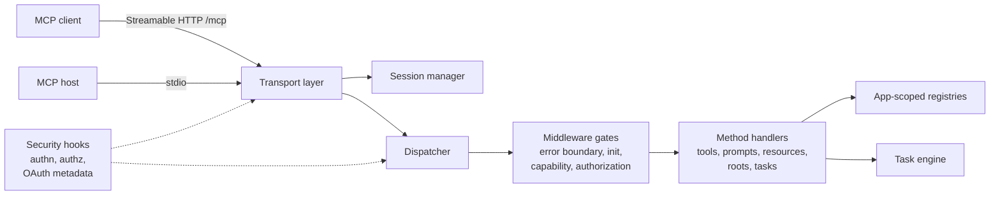

<div class="home-section">

An opinionated implementation of the Model Context Protocol for FastAPI. The spec leaves room for many designs; `pymcp-kit` picks one: a small built-in transport surface, app-scoped registries, and the MCP features you typically need first: tools, prompts, resources, roots, task-aware execution, optional auth hooks, OAuth protected-resource metadata, and opt-in draft MCP support.

Passes the official [MCP conformance suite](https://github.com/modelcontextprotocol/conformance) in full against the [2025-11-25 spec](https://modelcontextprotocol.io/specification/2025-11-25), verified in CI on every change.

## Opinionated by design

PyMCP Kit follows the MCP specification, and makes the choices the spec leaves open:

- **Two transports, nothing more.** Streamable HTTP at `/mcp` for networked clients and stdio for subprocess hosts.
- **Registries are app-scoped.** Register tools, prompts, and resources globally, and `create_app()` snapshots them into an isolated runtime.
- **Stable by default, draft by opt-in.** Stable MCP revisions are served by default; the draft `2026-07-28` stateless flow is something you enable.
- **Security is a hook, not a framework.** Authentication, authorization, and OAuth protected-resource metadata are optional hooks you add when you need them.
- **Conformance is checked, not claimed.** The official MCP conformance suite runs in CI on every change.

## Quick Install

```bash
pip install pymcp-kit
```

## How It Fits Together

`create_app()` snapshots the registries into an isolated runtime, mounts the
Streamable HTTP transport at `/mcp`, and routes every request through the same
dispatch pipeline that the stdio transport uses:



## What Ships Today

- Streamable HTTP mounted at `/mcp`
- Stdio transport through `run_stdio_server(app)`
- Stable MCP revisions by default, with opt-in draft `2026-07-28` stateless support
- Tool, prompt, and resource registries
- Roots and resource subscriptions
- Task-aware tool execution with progress, cancellation, and elicitation
- Optional authentication, authorization, and OAuth protected-resource metadata hooks

## Main Protocol Surface

- Lifecycle: `initialize`, `ping`, `notifications/initialized`, `notifications/cancelled`
- Tools: `tools/list`, `tools/call`
- Prompts: `prompts/list`, `prompts/get`
- Resources: `resources/list`, `resources/read`, `resources/subscribe`, `resources/unsubscribe`
- Roots: `roots/list`
- Tasks: `tasks/list`, `tasks/get`, `tasks/cancel`, `tasks/result`
- Draft discovery: `server/discover` when draft mode is enabled

## Read Next

- [Getting Started](getting-started/): installation, the basic app factory flow, and the built-in transports.
- [Tasks](tasks/): task-aware tool execution, progress, cancellation, and result polling.
- [Security](security/): bearer tokens, rule-based authorization, and capability filtering.
- [Runtime Surface](runtime-surface/): protocol revisions, draft stateless flow, endpoints, and capability settings.
- [Docs Deployment](deployment/): how this site is built and deployed.
- [Release Process](release/): version bump, tag, GitHub Release, and PyPI publishing flow.

</div>
